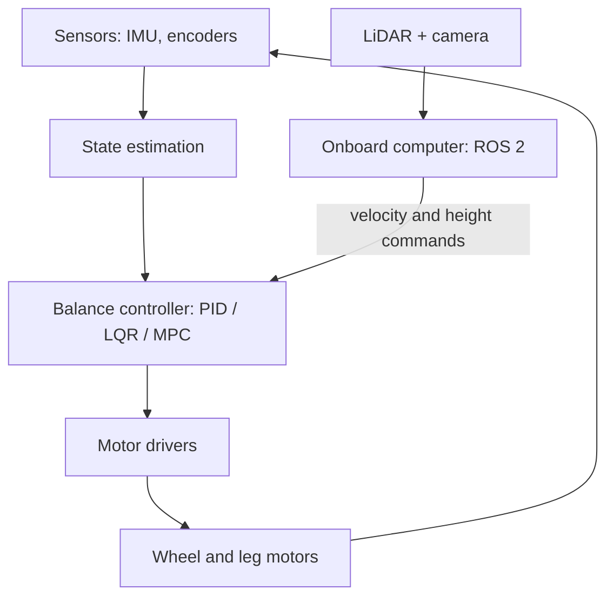

# Wheel-Legged Balancing Robot: Project Documentation

*Graduation project in Mechatronics Engineering: design, control, and comparison of LQR and MPC*

## 1. Project Overview

**Working title:** Design and Control of a Wheel-Legged Balancing Robot with LiDAR and Vision-Based Perception: A Comparison of LQR and MPC

This project designs, builds, and controls a two-wheeled balancing robot in which each wheel is mounted on an adjustable-height leg. The robot is an inverted-pendulum system: it is naturally unstable and must be actively controlled to stay upright. The legs let it change its body height, absorb bumps, and handle uneven ground.

The project has three connected parts:

1. **Mechatronic design and build:** the mechanical structure, actuators, sensors, electronics, and embedded software.
2. **Control:** the main scientific contribution, which is a controlled comparison of control algorithms (PID, LQR, and MPC) on the same robot.
3. **Perception:** a LiDAR and camera layer that demonstrates what the balancing platform can do, such as obstacle avoidance and object following.

The goal is a graduation project that is technically solid, measurable, and well documented, so it supports an application to a master's program.

&#91;image: image.png\]

## 2. Objectives

### Main objective

Design and build a wheel-legged balancing robot, and compare LQR and MPC on it using repeatable experiments and quantitative results.

### Supporting objectives

- Derive a mathematical model of the robot that includes leg height as a parameter.
- Validate the controllers in simulation before testing on hardware.
- Build a two-layer software architecture that separates fast balance control from slower perception.
- Add LiDAR and camera perception on top of the stable platform.
- Document everything (model, code, results) so the work is reproducible.

### Scope rule

The control comparison is the core of the project. Perception is a layer built on top of it. If time or budget becomes tight, perception features are reduced first, never the control comparison.

## 3. What the Robot Must Do

Requirements are grouped into three levels, so the project has a safe fallback at each stage.

### Minimum level

- Balance on its wheels.
- Drive forward and backward, and turn, under remote control.

### Good level

- Change leg height while balancing.
- Recover from pushes and disturbances.
- Stay level on mildly uneven ground.
- Climb a step or curb.

### Great level (master's-application level)

- Run both LQR and MPC on the real robot and compare them with measured results.
- Jump over a small obstacle or drop.
- Detect obstacles and navigate autonomously using LiDAR and a camera.

## 4. System Architecture

The system uses two layers. This separation is a key design rule.

### Low level: real-time controller (microcontroller)

- Reads the IMU and wheel/leg encoders.
- Estimates the robot's state (pitch, pitch rate, speed, position, yaw rate).
- Runs the balance controller in a fast, fixed-rate loop.
- Drives the motors through the motor drivers.
- Enforces hard safety limits on torque, tilt angle, and speed.

### High level: onboard computer (single-board computer running ROS 2)

- Processes LiDAR scans and camera images.
- Runs mapping, localization, navigation, and object detection.
- Sends high-level commands (desired velocity, turn rate, leg height) to the low-level controller.

### Design rules

- **Perception must never block the balance loop.** If the high-level computer slows down or crashes, the robot must still stay upright or shut down safely.
- The low-level controller has the final say. It ignores or limits any command that would make the robot unsafe.
- The communication link between the two layers is kept simple and robust, with a timeout that triggers a safe state if messages stop arriving.

## 5. Components

This section lists component types and their roles. Exact models and specifications are chosen later, based on the robot's mass, torque needs, and budget.

### 5.1 Mechanical structure

- **Body frame:** holds the battery, electronics, and computer. Designed in CAD and made by 3D printing or light machining.
- **Legs:** linkage mechanisms that change the body height. Two options: a simpler leg that changes height only, or a more capable multi-joint linkage (for example a five-bar linkage). The simpler leg is the budget fallback.
- **Wheels:** one per leg, with good grip and low play.
- **Handles and mounts:** for safe handling during tests, plus mounts for sensors.

### 5.2 Actuators

- **Wheel motors:** brushless motors with field-oriented control (FOC), so torque can be commanded directly.
- **Leg motors:** brushless motors with FOC and enough torque to hold and move the body weight.
- **Motor drivers:** FOC-capable drivers matched to the motors.
- **Why not hobby servos:** they cannot be torque-controlled, which the controllers in this project need.

### 5.3 Sensors

- **IMU:** measures body tilt and tilt rate. This is the most important sensor for balancing.
- **Encoders:** measure wheel rotation and leg joint angles.
- **2D LiDAR:** measures distance to surroundings for obstacle detection and mapping.
- **Camera:** provides images for object detection and for recognizing steps or curbs.

### 5.4 Computing

- **Microcontroller:** runs the real-time balance loop. It must be fast enough for the chosen controller. Since MPC is heavier than LQR, the microcontroller is chosen at the start with MPC in mind, to avoid redesigning the electronics later.
- **Single-board computer:** runs ROS 2, SLAM, navigation, and vision.

### 5.5 Power system

- **Battery:** sized for motor current peaks plus the onboard computer and sensors.
- **Power distribution:** separate, well-protected supply lines for motors and for the computer, with voltage regulation and noise isolation.
- **Protection:** fuse or current limiting, and an emergency cut-off switch.

### 5.6 Safety and test equipment

- Emergency stop.
- Tether or test stand for the first runs of each new controller.
- Force measurement or a repeatable disturbance method (such as a swinging weight) for push tests.
- Data logging on the microcontroller or computer to record sensor data and commands during every test.

## 6. Modeling

A shared mathematical model is the foundation of both controllers.

1. **Dynamics:** derive the equations of motion of an inverted pendulum on two wheels, with leg height as a parameter (the height changes the center of mass and the moment of inertia).
2. **Linearization:** linearize around the upright position to obtain a state-space model of the form x' = Ax + Bu.
3. **State vector:** wheel position, forward speed, pitch angle, pitch rate, and yaw rate.
4. **Inputs:** wheel torques, and later the leg commands.
5. **Parameters:** body mass, center of mass, inertia, wheel radius, and friction. These are measured carefully, and refined with system identification from logged data if needed.
6. **Leg height dependence:** the model is computed at several leg heights, since the dynamics change with height.

The same model is used for LQR, for MPC, and in simulation.

## 7. Control Algorithms

### 7.1 PID (learning step and baseline)

- Built first on a small, simple two-wheel balancing robot.
- Typically stacked loops: one for angle, one for speed, one for turning.
- Purpose: learn IMU filtering, motor control, and the feel of balancing, and provide a baseline for the comparison.
- Limits: loops interact, tuning is trial and error, no model is used, and gains tuned at one leg height may fail at another.

### 7.2 LQR (main controller)

- Uses the state-space model and computes the control law u = -Kx.
- Tuned by choosing two weighting matrices: **Q** (how much each state error matters) and **R** (how much motor effort costs).
- Handles all states together, including their interactions.
- **Gain scheduling:** a separate gain matrix K is computed for each leg height, and the robot switches or interpolates between them.
- Very cheap to compute: only a matrix multiplication per cycle.
- Limits: assumes behavior near linear (small angles), and does not know about torque limits.

### 7.3 MPC (advanced controller)

- Uses the same model to predict the robot's behavior over a short horizon, and solves an optimization problem each cycle to find the best torque sequence. It applies the first torque and repeats.
- Handles constraints explicitly: motor torque limits, leg range, tilt limits, and current limits.
- Can plan ahead, which helps with reference trajectories and step climbing.
- Cost: heavy computation, because a QP problem must be solved within each control period. This needs an efficient solver and a suitable processor.
- Limits: sensitive to a poor model and to a solver that runs too slowly.

### 7.4 Controller summary

|  | PID | LQR | MPC |
| --- | --- | --- | --- |
| Needs a model | No | Yes | Yes |
| Handles several states together | Poorly (stacked loops) | Yes | Yes |
| Handles constraints | No | No | Yes |
| Implementation difficulty | Low | Medium | High |
| Computation | Very low | Very low | High |
| Role in the project | Learning step and baseline | Main controller | Advanced controller |

## 8. Perception

Perception runs on the onboard computer and is built on top of a stable balancing platform. Features are added in order of difficulty:

1. **Obstacle detection and avoidance** from LiDAR scans.
2. **2D mapping and autonomous navigation** (SLAM and a navigation stack in ROS 2).
3. **Object or person detection and following** using a lightweight neural network on the camera feed.
4. **Step or curb detection**, so the robot can decide when to climb.

### Known technical problem: tilting sensors

A balancing robot constantly tilts, so the LiDAR scan and camera view tilt with it. The project compensates using IMU data (or keeps the sensor level through the legs). Solving this well is a good thesis topic in its own right.

### Weight and power

The computer, LiDAR, and camera add weight and current draw. The frame and battery are designed for them from the start.

## 9. Simulation

Every controller is tested in simulation before the real robot.

- **Tools:** MATLAB/Simulink, or a physics simulator such as MuJoCo or PyBullet.
- **Uses:** tuning Q, R, and MPC parameters, checking solver speed, testing disturbances and robustness, and deciding which experiments are worth running on hardware.
- **Benefit:** it protects the hardware and saves time, because a bad controller can destroy motors or the frame in a fraction of a second.

A good first exercise is an inverted pendulum on a cart in MATLAB or Python, with both LQR and MPC designed and compared. It is small enough to finish quickly and becomes the prototype for the thesis comparison.

## 10. Comparison Methodology: LQR vs MPC

This is the core scientific part of the project.

### 10.1 Idea

The same robot is controlled by two different algorithms. The same tests are run on both. Only the control software changes. The result answers the question: *which controller is better, and under what conditions?*

### 10.2 Why this comparison matters

- It turns a build into engineering research.
- It shows that the student can evaluate results, not only build hardware.
- It gives the thesis a natural structure: model, controllers, experiments, discussion.
- It protects the project: an honest comparison is a valid result even if MPC does not win.

### 10.3 Fairness rules

For the comparison to be valid:

- **Same hardware:** same robot, sensors, motors, and battery. No extra hardware is needed for one controller, except that the processor must be capable enough for MPC from the start.
- **Same model:** both controllers use the same A and B matrices.
- **Same cost weights:** start with the same Q and R in both, so only the method of solving the problem differs.
- **Same sensing:** the same state estimation and sensor filtering.
- **Same control rate:** or any difference is documented.
- **Similar tuning effort:** for example, the same number of tuning sessions for each.
- **Separate tuning and evaluation tests:** tune on one set of tests and evaluate on a different set, so neither controller is overfitted.
- **Recorded parameters:** all final parameters are written down so the experiment can be reproduced.

### 10.4 What is tuned

| Controller | Tuned items |
| --- | --- |
| LQR | Weights Q and R (these give the gains K), one set per leg height |
| MPC | The same Q and R, plus prediction horizon, constraint limits, and solver settings |

Most tuning is done in simulation first, then refined on the robot.

### 10.5 Experiments

Every experiment is run on both controllers under identical conditions.

| Experiment | What it tests | Metrics |
| --- | --- | --- |
| Push recovery | Disturbance rejection | Largest disturbance survived, settling time, peak pitch error |
| Speed command step | Normal tracking | Rise time, overshoot, steady-state error |
| Torque-limit stress | Behavior when motors saturate | Stability, recovery, peak tilt |
| Leg-height change while balancing | Changing dynamics | Pitch error during the transition |
| Operation at low, medium, and high leg height | Robustness across configurations | All of the metrics above at each height |
| Step climbing (stretch goal) | Constraint-aware planning | Success rate |
| Computation | Practicality | Time per control cycle, processor load |
| Energy use | Efficiency | Battery consumption for the same task |

### 10.6 Robustness tests

These show how sensitive each controller is to imperfect conditions:

- **Model error:** add a known weight to the body so the real robot differs from the model.
- **Sensor noise:** increase noise in the sensor signals (simulation first).
- **Delay:** add a small delay in the control loop (simulation first).

These tests are where LQR and MPC often behave differently.

### 10.7 Statistics and repetition

- Repeat each experiment many times for each controller.
- Report the mean and the spread (for example, standard deviation) rather than a single run.
- Log raw data from every test so results can be re-analyzed.

### 10.8 Analysis and presentation

- Plots of pitch angle and torque over time for the same disturbance on both controllers.
- A summary table of all metrics.
- A discussion explaining the results with theory, for example whether LQR struggled because it does not know the torque limit, or whether MPC suffered because of model error or solver delay.
- Honest statements about where MPC's extra computation was and was not worth it.

### 10.9 Expected outcome

The result cannot be promised, because it depends on the robot and tuning, but the usual pattern is:

- **LQR:** fast, cheap, and effective near the balanced position. It struggles when the motors saturate and needs separate gains for each leg height.
- **MPC:** better under hard disturbances and near torque limits, and smoother in leg-height changes and steps. Its costs are heavy computation and sensitivity to a poor model or slow solver.
- **Likely conclusion:** LQR is enough for normal balancing, and MPC gives a measurable improvement in demanding situations at the cost of more computation. If the two perform about the same, that is still a valid and interesting finding.

PID is included as a third data point (PID vs LQR vs MPC), which makes the comparison richer.

## 11. Machine Learning in the Project

ML is kept in supporting roles so the control comparison stays the core.

- **Included:** a lightweight object detector for the vision features.
- **Low-risk options:** Bayesian optimization to tune Q and R automatically (the same tuning budget for both controllers supports fairness), and system identification to fit the robot's real parameters from logged data.
- **Optional:** residual learning on top of LQR, or full reinforcement learning in simulation.

## 12. Software and Tools

- **Embedded:** C/C++ on the microcontroller, with real-time loops and sensor reading.
- **High level:** ROS 2, with Python and C++.
- **Modeling and simulation:** MATLAB/Simulink, MuJoCo or PyBullet.
- **Optimization:** a QP solver for MPC (for example OSQP, or generated code from a tool such as acados).
- **Perception:** OpenCV, a LiDAR driver, SLAM and navigation packages, and a lightweight detection model.
- **Mechanical:** CAD software and 3D printing.
- **Version control and documentation:** GitHub, a technical report, and a demo video.

## 13. Skills Required

- **Control:** PID, state-space modeling, linearization, LQR (including the Riccati equation and choice of Q and R), and MPC basics (prediction model, cost, constraints, QP).
- **Modeling and simulation:** inverted-pendulum dynamics, leg kinematics, simulation tools.
- **Embedded programming:** C/C++, real-time loops, IMU filtering (complementary and Kalman filters), sensor fusion.
- **Motor control:** brushless motors, FOC, encoders, torque control.
- **Mechanical design:** CAD, 3D printing, leg linkage design.
- **Electronics:** power distribution, motor drivers, wiring, and basic PCB work.
- **Software and perception:** ROS 2, SLAM, LiDAR processing, OpenCV, model deployment.
- **Professional:** statistics for presenting results, GitHub, technical writing, and video demonstration.

## 14. Risks and Mitigations

| Risk | Mitigation |
| --- | --- |
| Budget, mainly the leg motors | Use the simpler height-only leg as a fallback |
| Scope creep | Keep the control comparison as the core and perception as a layer on top |
| Weight and power of the computer, LiDAR, and camera | Design the frame and battery for them from the start |
| MPC too slow on the hardware | Check solver time in simulation early and choose the microcontroller accordingly |
| Model mismatch | Measure mass, center of mass, and wheel radius carefully, and use system identification |
| Unfair tuning | Document the tuning process and use the same effort for both controllers |
| Hardware damage from a bad controller | Test in simulation first, use a tether or stand, and enforce hard limits in the low-level firmware |
| Learning curve | Start with PID on a simple robot, then build up to LQR and MPC |

## 15. Expected Deliverables

- A working wheel-legged balancing robot.
- The mathematical model and its derivation.
- Simulation models and results.
- PID, LQR, and MPC implementations.
- The experimental comparison with plots, tables, and discussion.
- The perception system (obstacle avoidance, navigation, and object following as far as completed).
- Source code and parameters on GitHub.
- A technical report (the thesis) and a demonstration video.

## 16. Note for a Future Version (Version 2)

An idea discussed and deliberately left out of this project: an AI agent that watches the robot with a room camera and tunes parameters or writes control code on its own.

It is excluded for two reasons. First, safety: an unbalanced robot falls in a fraction of a second, so an AI cannot sit in the fast loop, and generated code could damage the hardware. Second, sensing: a room camera is a weak feedback source compared with the robot's own IMU and encoders, which give exact numbers at a much higher rate.

If revisited in a future version, the safe design would keep the classical controller (LQR or MPC) in the fast loop, let the AI work only at the parameter-tuning level on a laptop, check every proposal in simulation first, keep hard safety limits in the low-level firmware, and use logged sensor data as the main feedback, with the camera as extra context only.
